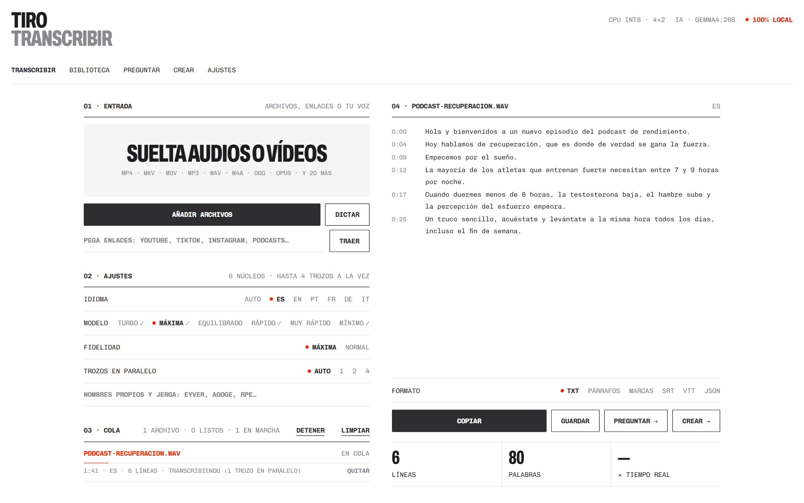
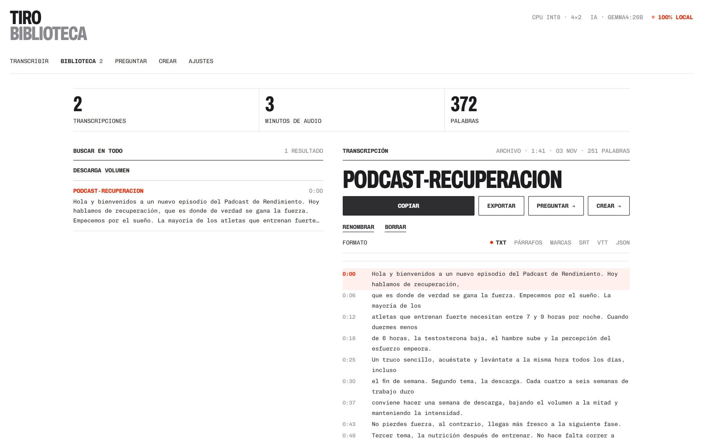
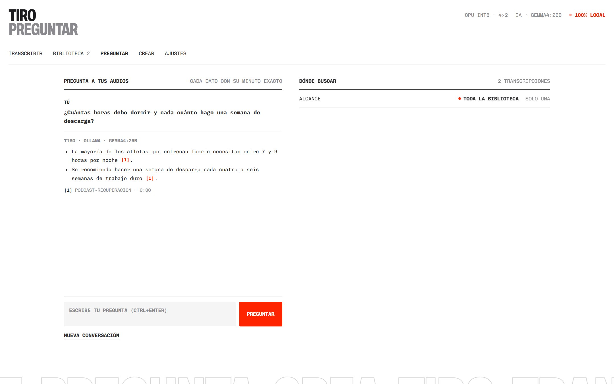
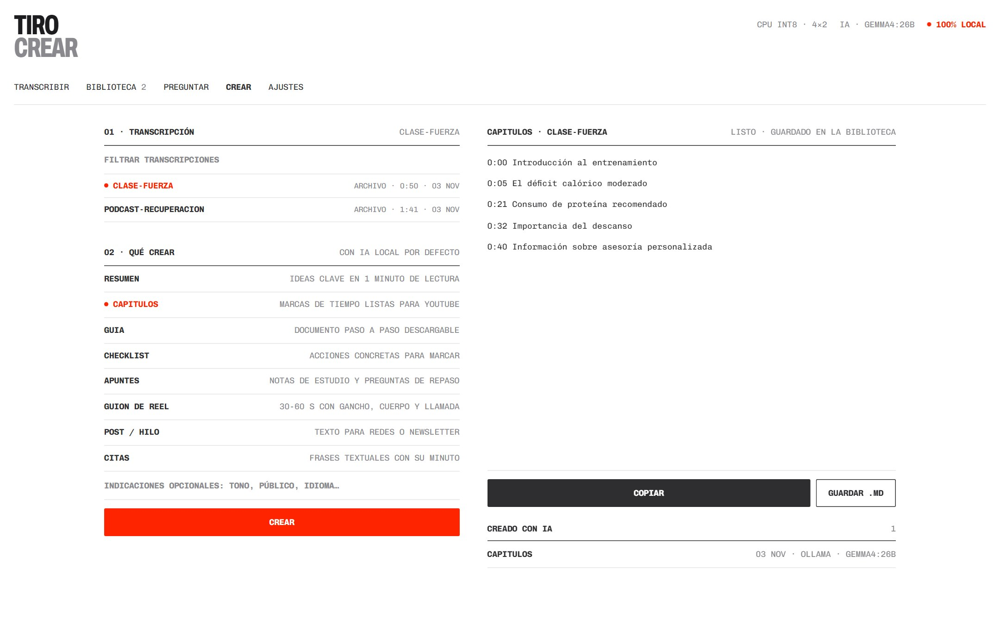
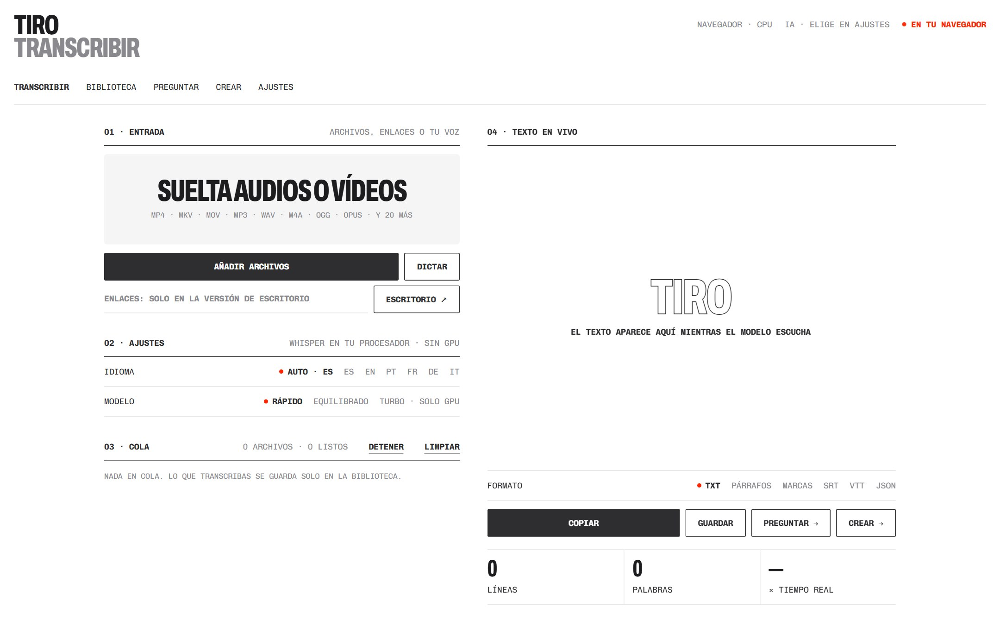
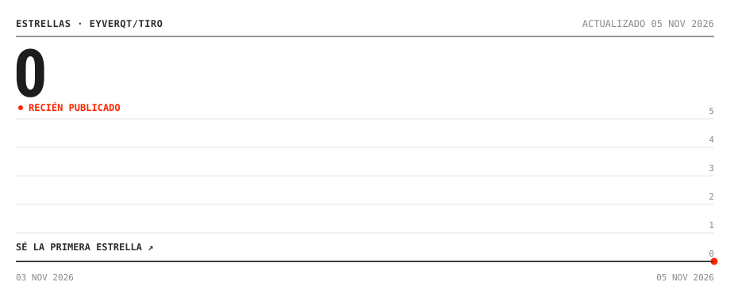

<h1>TIRO</h1>

<p><samp>APP&nbsp;DE&nbsp;TRANSCRIPCIÓN&nbsp;&nbsp;&nbsp;&nbsp;&nbsp;&nbsp;<b>TRANSCRIBE,&nbsp;PREGUNTA&nbsp;Y&nbsp;CREA</b>&nbsp;&nbsp;&nbsp;&nbsp;&nbsp;&nbsp;<b>●&nbsp;v1.0&nbsp;·&nbsp;PÚBLICO</b></samp></p>

<br>

<p align="center"></p>

<p align="center"><samp><a href="https://eyverqt.netlify.app/tiro/app/"><b>▶&nbsp;ABRIR&nbsp;EN&nbsp;EL&nbsp;NAVEGADOR</b></a>&nbsp;&nbsp;&nbsp;&nbsp;&nbsp;&nbsp;<a href="#instalar"><b>↓&nbsp;INSTALAR&nbsp;EN&nbsp;WINDOWS</b></a>&nbsp;&nbsp;&nbsp;&nbsp;&nbsp;&nbsp;<a href="https://eyverqt.netlify.app/tiro"><b>VER&nbsp;EN&nbsp;EL&nbsp;PORTFOLIO</b></a></samp></p>

<br>

<p align="center"><samp>
<b>TIRO:&nbsp;&nbsp;&nbsp;&nbsp;&nbsp;&nbsp;&nbsp;&nbsp;&nbsp;&nbsp;&nbsp;&nbsp;&nbsp;&nbsp;&nbsp;&nbsp;&nbsp;(TU&nbsp;AUDIO&nbsp;NO&nbsp;SALE&nbsp;DE&nbsp;TU&nbsp;EQUIPO)&nbsp;&nbsp;&nbsp;&nbsp;&nbsp;&nbsp;&nbsp;&nbsp;&nbsp;&nbsp;&nbsp;&nbsp;&nbsp;&nbsp;&nbsp;&nbsp;&nbsp;&nbsp;&nbsp;&nbsp;</b><br>
<br>
<b>ÍNDICE&nbsp;01:&nbsp;QUÉ&nbsp;HACE&nbsp;&nbsp;&nbsp;(ARCHIVOS,&nbsp;ENLACES&nbsp;Y&nbsp;VOZ&nbsp;→&nbsp;TEXTO&nbsp;AL&nbsp;SEGUNDO)&nbsp;&nbsp;&nbsp;&nbsp;&nbsp;&nbsp;&nbsp;</b><br>
<br>
<b>ÍNDICE&nbsp;02:&nbsp;NOVEDADES&nbsp;&nbsp;(v1.0:&nbsp;CUATRO&nbsp;HERRAMIENTAS&nbsp;EN&nbsp;UNA&nbsp;SOLA&nbsp;APP)&nbsp;&nbsp;&nbsp;&nbsp;&nbsp;&nbsp;&nbsp;&nbsp;</b><br>
<br>
<b>ÍNDICE&nbsp;03:&nbsp;POR&nbsp;QUÉ&nbsp;&nbsp;&nbsp;&nbsp;(FRENTE&nbsp;A&nbsp;TURBOSCRIBE,&nbsp;OTTER,&nbsp;MACWHISPER…)&nbsp;&nbsp;&nbsp;&nbsp;&nbsp;&nbsp;&nbsp;&nbsp;&nbsp;</b><br>
<br>
<b>ÍNDICE&nbsp;04:&nbsp;DOS&nbsp;MODOS&nbsp;&nbsp;(EN&nbsp;EL&nbsp;NAVEGADOR&nbsp;SIN&nbsp;INSTALAR&nbsp;O&nbsp;EN&nbsp;WINDOWS)&nbsp;&nbsp;&nbsp;&nbsp;&nbsp;&nbsp;&nbsp;&nbsp;</b><br>
<br>
<b>ÍNDICE&nbsp;05:&nbsp;INSTALAR&nbsp;&nbsp;&nbsp;(START.BAT&nbsp;CON&nbsp;PYTHON&nbsp;3.12&nbsp;Y&nbsp;FFMPEG)&nbsp;&nbsp;&nbsp;&nbsp;&nbsp;&nbsp;&nbsp;&nbsp;&nbsp;&nbsp;&nbsp;&nbsp;&nbsp;&nbsp;&nbsp;</b><br>
<br>
<b>ÍNDICE&nbsp;06:&nbsp;USAR&nbsp;&nbsp;&nbsp;&nbsp;&nbsp;&nbsp;&nbsp;(SOLTAR,&nbsp;PEGAR,&nbsp;DICTAR,&nbsp;PREGUNTAR&nbsp;Y&nbsp;CREAR)&nbsp;&nbsp;&nbsp;&nbsp;&nbsp;&nbsp;&nbsp;&nbsp;&nbsp;</b><br>
<br>
<b>ÍNDICE&nbsp;07:&nbsp;GALERÍA&nbsp;&nbsp;&nbsp;&nbsp;(BIBLIOTECA,&nbsp;PREGUNTAR,&nbsp;CREAR&nbsp;Y&nbsp;VERSIÓN&nbsp;WEB)&nbsp;&nbsp;&nbsp;&nbsp;&nbsp;&nbsp;&nbsp;</b><br>
<br>
<b>ÍNDICE&nbsp;08:&nbsp;LICENCIA&nbsp;&nbsp;&nbsp;(CÓDIGO&nbsp;MIT,&nbsp;CONTENIDO&nbsp;©&nbsp;EYVER&nbsp;GÓMEZ)&nbsp;&nbsp;&nbsp;&nbsp;&nbsp;&nbsp;&nbsp;&nbsp;&nbsp;&nbsp;&nbsp;&nbsp;&nbsp;&nbsp;</b><br>
<br>
<br>
<br>
Tu&nbsp;audio,&nbsp;tu&nbsp;vídeo&nbsp;o&nbsp;tu&nbsp;voz,&nbsp;en&nbsp;texto&nbsp;exacto&nbsp;con&nbsp;el&nbsp;minuto&nbsp;de&nbsp;cada&nbsp;frase.<br>
Busca&nbsp;cualquier&nbsp;palabra&nbsp;en&nbsp;todo&nbsp;lo&nbsp;que&nbsp;has&nbsp;transcrito,&nbsp;al&nbsp;segundo.&nbsp;&nbsp;&nbsp;&nbsp;&nbsp;&nbsp;&nbsp;<br>
Pregunta&nbsp;y&nbsp;la&nbsp;respuesta&nbsp;llega&nbsp;con&nbsp;citas&nbsp;que&nbsp;abren&nbsp;ese&nbsp;minuto&nbsp;exacto.&nbsp;&nbsp;&nbsp;&nbsp;&nbsp;<br>
Convierte&nbsp;cualquier&nbsp;audio&nbsp;en&nbsp;capítulos,&nbsp;guías,&nbsp;checklists&nbsp;o&nbsp;reels.&nbsp;&nbsp;&nbsp;&nbsp;&nbsp;&nbsp;&nbsp;<br>
Whisper&nbsp;y&nbsp;la&nbsp;IA&nbsp;corren&nbsp;en&nbsp;tu&nbsp;equipo&nbsp;o&nbsp;en&nbsp;tu&nbsp;navegador:&nbsp;nada&nbsp;se&nbsp;sube.&nbsp;&nbsp;&nbsp;&nbsp;&nbsp;<br>
Sin&nbsp;cuentas,&nbsp;sin&nbsp;minutos&nbsp;contados&nbsp;y&nbsp;sin&nbsp;suscripción.&nbsp;Gratis.&nbsp;&nbsp;&nbsp;&nbsp;&nbsp;&nbsp;&nbsp;&nbsp;&nbsp;&nbsp;&nbsp;&nbsp;&nbsp;
</samp></p>

<br>

<p align="center"><samp>
<b>ÍNDICE&nbsp;01:&nbsp;QUÉ&nbsp;HACE&nbsp;&nbsp;&nbsp;(ARCHIVOS,&nbsp;ENLACES&nbsp;Y&nbsp;VOZ&nbsp;→&nbsp;TEXTO&nbsp;AL&nbsp;SEGUNDO)&nbsp;&nbsp;&nbsp;&nbsp;</b><br>
<br>
Sueltas&nbsp;un&nbsp;audio,&nbsp;un&nbsp;vídeo&nbsp;o&nbsp;un&nbsp;enlace,&nbsp;o&nbsp;simplemente&nbsp;hablas,&nbsp;y&nbsp;sale&nbsp;&nbsp;<br>
el&nbsp;texto&nbsp;exacto&nbsp;con&nbsp;el&nbsp;minuto&nbsp;de&nbsp;cada&nbsp;frase.&nbsp;Todo&nbsp;queda&nbsp;en&nbsp;una&nbsp;&nbsp;&nbsp;&nbsp;&nbsp;&nbsp;&nbsp;&nbsp;<br>
biblioteca&nbsp;donde&nbsp;buscas&nbsp;cualquier&nbsp;palabra,&nbsp;preguntas&nbsp;«¿qué&nbsp;dijo&nbsp;sobre&nbsp;<br>
el&nbsp;déficit&nbsp;calórico?»&nbsp;y&nbsp;recibes&nbsp;la&nbsp;respuesta&nbsp;con&nbsp;el&nbsp;minuto&nbsp;exacto,&nbsp;o&nbsp;&nbsp;<br>
conviertes&nbsp;la&nbsp;transcripción&nbsp;en&nbsp;un&nbsp;resumen,&nbsp;los&nbsp;capítulos&nbsp;para&nbsp;YouTube,<br>
una&nbsp;guía,&nbsp;un&nbsp;checklist&nbsp;o&nbsp;el&nbsp;guion&nbsp;de&nbsp;un&nbsp;reel.&nbsp;&nbsp;&nbsp;&nbsp;&nbsp;&nbsp;&nbsp;&nbsp;&nbsp;&nbsp;&nbsp;&nbsp;&nbsp;&nbsp;&nbsp;&nbsp;&nbsp;&nbsp;&nbsp;&nbsp;&nbsp;&nbsp;&nbsp;&nbsp;&nbsp;<br>
<br>
<b>CÓMO&nbsp;FUNCIONA:&nbsp;&nbsp;&nbsp;&nbsp;&nbsp;&nbsp;&nbsp;&nbsp;&nbsp;&nbsp;&nbsp;&nbsp;&nbsp;&nbsp;&nbsp;&nbsp;&nbsp;&nbsp;&nbsp;&nbsp;&nbsp;&nbsp;&nbsp;&nbsp;&nbsp;&nbsp;&nbsp;&nbsp;&nbsp;&nbsp;&nbsp;&nbsp;&nbsp;&nbsp;&nbsp;&nbsp;&nbsp;&nbsp;&nbsp;&nbsp;&nbsp;&nbsp;&nbsp;&nbsp;&nbsp;&nbsp;&nbsp;&nbsp;&nbsp;&nbsp;&nbsp;&nbsp;&nbsp;&nbsp;&nbsp;&nbsp;</b><br>
<br>
ARCHIVO&nbsp;·&nbsp;ENLACE&nbsp;·&nbsp;VOZ&nbsp;&nbsp;&nbsp;&nbsp;&nbsp;&nbsp;&nbsp;&nbsp;&nbsp;&nbsp;&nbsp;&nbsp;&nbsp;&nbsp;&nbsp;&nbsp;&nbsp;&nbsp;&nbsp;&nbsp;&nbsp;&nbsp;&nbsp;&nbsp;&nbsp;&nbsp;&nbsp;&nbsp;&nbsp;&nbsp;&nbsp;&nbsp;&nbsp;&nbsp;&nbsp;&nbsp;&nbsp;&nbsp;&nbsp;&nbsp;&nbsp;&nbsp;&nbsp;&nbsp;&nbsp;&nbsp;&nbsp;&nbsp;<br>
→&nbsp;WHISPER&nbsp;LOCAL&nbsp;&nbsp;&nbsp;&nbsp;&nbsp;&nbsp;&nbsp;(TROZOS&nbsp;POR&nbsp;SILENCIO,&nbsp;EN&nbsp;PARALELO)&nbsp;&nbsp;&nbsp;&nbsp;&nbsp;&nbsp;&nbsp;&nbsp;&nbsp;&nbsp;&nbsp;&nbsp;&nbsp;&nbsp;<br>
→&nbsp;BIBLIOTECA&nbsp;&nbsp;&nbsp;&nbsp;&nbsp;&nbsp;&nbsp;&nbsp;&nbsp;&nbsp;(BÚSQUEDA&nbsp;BM25&nbsp;CON&nbsp;SU&nbsp;SEGUNDO)&nbsp;&nbsp;&nbsp;&nbsp;&nbsp;&nbsp;&nbsp;&nbsp;&nbsp;&nbsp;&nbsp;&nbsp;&nbsp;&nbsp;&nbsp;&nbsp;&nbsp;&nbsp;<br>
→&nbsp;PREGUNTAR&nbsp;&nbsp;&nbsp;&nbsp;&nbsp;&nbsp;&nbsp;&nbsp;&nbsp;&nbsp;&nbsp;(CITAS&nbsp;[1]&nbsp;QUE&nbsp;ABREN&nbsp;ESE&nbsp;MINUTO)&nbsp;&nbsp;&nbsp;&nbsp;&nbsp;&nbsp;&nbsp;&nbsp;&nbsp;&nbsp;&nbsp;&nbsp;&nbsp;&nbsp;&nbsp;&nbsp;<br>
→&nbsp;CREAR&nbsp;&nbsp;&nbsp;&nbsp;&nbsp;&nbsp;&nbsp;&nbsp;&nbsp;&nbsp;&nbsp;&nbsp;&nbsp;&nbsp;&nbsp;(RESUMEN,&nbsp;CAPÍTULOS,&nbsp;GUÍA,&nbsp;CHECKLIST,&nbsp;REEL)&nbsp;&nbsp;&nbsp;&nbsp;&nbsp;<br>
→&nbsp;EXPORTAR&nbsp;&nbsp;&nbsp;&nbsp;&nbsp;&nbsp;&nbsp;&nbsp;&nbsp;&nbsp;&nbsp;&nbsp;(TXT,&nbsp;PÁRRAFOS,&nbsp;MARCAS,&nbsp;SRT,&nbsp;VTT,&nbsp;JSON)&nbsp;&nbsp;&nbsp;&nbsp;&nbsp;&nbsp;&nbsp;&nbsp;&nbsp;
</samp></p>

<br>

<p align="center"><samp>
<b>ÍNDICE&nbsp;02:&nbsp;NOVEDADES&nbsp;&nbsp;(v1.0:&nbsp;CUATRO&nbsp;HERRAMIENTAS&nbsp;EN&nbsp;UNA&nbsp;SOLA&nbsp;APP)&nbsp;&nbsp;&nbsp;&nbsp;</b><br>
<br>
<b>2026-11&nbsp;·&nbsp;TIRO&nbsp;1.0&nbsp;&nbsp;&nbsp;&nbsp;&nbsp;&nbsp;&nbsp;&nbsp;&nbsp;&nbsp;&nbsp;&nbsp;&nbsp;&nbsp;&nbsp;&nbsp;&nbsp;&nbsp;&nbsp;&nbsp;&nbsp;&nbsp;&nbsp;&nbsp;&nbsp;&nbsp;&nbsp;&nbsp;&nbsp;&nbsp;&nbsp;&nbsp;&nbsp;&nbsp;&nbsp;&nbsp;&nbsp;&nbsp;&nbsp;&nbsp;&nbsp;&nbsp;&nbsp;&nbsp;&nbsp;&nbsp;&nbsp;&nbsp;&nbsp;&nbsp;&nbsp;</b><br>
<br>
El&nbsp;transcriptor&nbsp;offline,&nbsp;el&nbsp;dictado,&nbsp;el&nbsp;chat&nbsp;sobre&nbsp;transcripciones&nbsp;y&nbsp;<br>
el&nbsp;generador&nbsp;de&nbsp;recursos&nbsp;de&nbsp;vídeos&nbsp;ahora&nbsp;son&nbsp;una&nbsp;sola&nbsp;app,&nbsp;con&nbsp;una&nbsp;&nbsp;&nbsp;<br>
sola&nbsp;biblioteca.&nbsp;&nbsp;&nbsp;&nbsp;&nbsp;&nbsp;&nbsp;&nbsp;&nbsp;&nbsp;&nbsp;&nbsp;&nbsp;&nbsp;&nbsp;&nbsp;&nbsp;&nbsp;&nbsp;&nbsp;&nbsp;&nbsp;&nbsp;&nbsp;&nbsp;&nbsp;&nbsp;&nbsp;&nbsp;&nbsp;&nbsp;&nbsp;&nbsp;&nbsp;&nbsp;&nbsp;&nbsp;&nbsp;&nbsp;&nbsp;&nbsp;&nbsp;&nbsp;&nbsp;&nbsp;&nbsp;&nbsp;&nbsp;&nbsp;&nbsp;&nbsp;&nbsp;&nbsp;<br>
<br>
●&nbsp;VERSIÓN&nbsp;WEB&nbsp;&nbsp;&nbsp;&nbsp;&nbsp;&nbsp;&nbsp;&nbsp;&nbsp;(SIN&nbsp;INSTALAR:&nbsp;WEBGPU,&nbsp;INDEXEDDB&nbsp;Y&nbsp;WEBLLM)&nbsp;&nbsp;&nbsp;&nbsp;&nbsp;<br>
●&nbsp;CITAS&nbsp;AL&nbsp;MINUTO&nbsp;&nbsp;&nbsp;&nbsp;&nbsp;(CADA&nbsp;[n]&nbsp;ABRE&nbsp;LA&nbsp;TRANSCRIPCIÓN&nbsp;EN&nbsp;ESE&nbsp;SEGUNDO)<br>
●&nbsp;1.000&nbsp;SITIOS&nbsp;&nbsp;&nbsp;&nbsp;&nbsp;&nbsp;&nbsp;&nbsp;(YOUTUBE,&nbsp;TIKTOK,&nbsp;INSTAGRAM,&nbsp;X,&nbsp;PODCASTS)&nbsp;&nbsp;&nbsp;&nbsp;&nbsp;&nbsp;<br>
●&nbsp;DICTADO&nbsp;&nbsp;&nbsp;&nbsp;&nbsp;&nbsp;&nbsp;&nbsp;&nbsp;&nbsp;&nbsp;&nbsp;&nbsp;(ALT+D:&nbsp;HABLAS,&nbsp;PARAS&nbsp;Y&nbsp;QUEDA&nbsp;COPIADO)&nbsp;&nbsp;&nbsp;&nbsp;&nbsp;&nbsp;&nbsp;&nbsp;&nbsp;
</samp></p>

<br>

<p align="center"><samp>
<b>ÍNDICE&nbsp;03:&nbsp;POR&nbsp;QUÉ&nbsp;&nbsp;&nbsp;&nbsp;(FRENTE&nbsp;A&nbsp;TURBOSCRIBE,&nbsp;OTTER,&nbsp;MACWHISPER…)&nbsp;&nbsp;&nbsp;&nbsp;&nbsp;&nbsp;</b><br>
<br>
<b>TIRO&nbsp;&nbsp;&nbsp;&nbsp;&nbsp;&nbsp;&nbsp;&nbsp;&nbsp;&nbsp;&nbsp;&nbsp;&nbsp;&nbsp;&nbsp;&nbsp;&nbsp;&nbsp;TU&nbsp;EQUIPO&nbsp;O&nbsp;NAVEGADOR&nbsp;·&nbsp;SIN&nbsp;LÍMITES&nbsp;·&nbsp;GRATIS&nbsp;&nbsp;&nbsp;&nbsp;</b><br>
TURBOSCRIBE&nbsp;&nbsp;&nbsp;&nbsp;&nbsp;&nbsp;&nbsp;&nbsp;&nbsp;&nbsp;&nbsp;NUBE&nbsp;·&nbsp;3&nbsp;ARCHIVOS&nbsp;AL&nbsp;DÍA&nbsp;DE&nbsp;30&nbsp;MIN&nbsp;·&nbsp;~10&nbsp;USD/MES<br>
OTTER.AI&nbsp;&nbsp;&nbsp;&nbsp;&nbsp;&nbsp;&nbsp;&nbsp;&nbsp;&nbsp;&nbsp;&nbsp;&nbsp;&nbsp;NUBE&nbsp;·&nbsp;300&nbsp;MIN&nbsp;AL&nbsp;MES&nbsp;·&nbsp;REUNIONES&nbsp;·&nbsp;~17&nbsp;USD/MES&nbsp;<br>
MACWHISPER&nbsp;&nbsp;&nbsp;&nbsp;&nbsp;&nbsp;&nbsp;&nbsp;&nbsp;&nbsp;&nbsp;&nbsp;LOCAL&nbsp;·&nbsp;SOLO&nbsp;MAC&nbsp;·&nbsp;LICENCIA&nbsp;DE&nbsp;PAGO&nbsp;&nbsp;&nbsp;&nbsp;&nbsp;&nbsp;&nbsp;&nbsp;&nbsp;&nbsp;&nbsp;&nbsp;&nbsp;<br>
NOTEBOOKLM&nbsp;&nbsp;&nbsp;&nbsp;&nbsp;&nbsp;&nbsp;&nbsp;&nbsp;&nbsp;&nbsp;&nbsp;NUBE&nbsp;DE&nbsp;GOOGLE&nbsp;·&nbsp;CON&nbsp;CUENTA&nbsp;·&nbsp;SIN&nbsp;MINUTO&nbsp;EXACTO&nbsp;<br>
WISPR&nbsp;FLOW&nbsp;&nbsp;&nbsp;&nbsp;&nbsp;&nbsp;&nbsp;&nbsp;&nbsp;&nbsp;&nbsp;&nbsp;NUBE&nbsp;·&nbsp;SOLO&nbsp;DICTADO&nbsp;·&nbsp;~15&nbsp;USD/MES&nbsp;&nbsp;&nbsp;&nbsp;&nbsp;&nbsp;&nbsp;&nbsp;&nbsp;&nbsp;&nbsp;&nbsp;&nbsp;&nbsp;&nbsp;<br>
<br>
<b>LO&nbsp;QUE&nbsp;HACE&nbsp;MEJOR:&nbsp;&nbsp;&nbsp;&nbsp;&nbsp;&nbsp;&nbsp;&nbsp;&nbsp;&nbsp;&nbsp;&nbsp;&nbsp;&nbsp;&nbsp;&nbsp;&nbsp;&nbsp;&nbsp;&nbsp;&nbsp;&nbsp;&nbsp;&nbsp;&nbsp;&nbsp;&nbsp;&nbsp;&nbsp;&nbsp;&nbsp;&nbsp;&nbsp;&nbsp;&nbsp;&nbsp;&nbsp;&nbsp;&nbsp;&nbsp;&nbsp;&nbsp;&nbsp;&nbsp;&nbsp;&nbsp;&nbsp;&nbsp;&nbsp;&nbsp;&nbsp;&nbsp;</b><br>
<br>
●&nbsp;MÁS&nbsp;FIEL&nbsp;&nbsp;&nbsp;&nbsp;&nbsp;&nbsp;&nbsp;&nbsp;&nbsp;&nbsp;&nbsp;&nbsp;(VAD,&nbsp;SIN&nbsp;BUCLES,&nbsp;REINTENTOS&nbsp;Y&nbsp;JERGA&nbsp;PROPIA)&nbsp;&nbsp;&nbsp;&nbsp;<br>
●&nbsp;MÁS&nbsp;RÁPIDO&nbsp;&nbsp;&nbsp;&nbsp;&nbsp;&nbsp;&nbsp;&nbsp;&nbsp;&nbsp;(TROZOS&nbsp;EN&nbsp;PARALELO:&nbsp;1,7×&nbsp;EN&nbsp;8&nbsp;NÚCLEOS)&nbsp;&nbsp;&nbsp;&nbsp;&nbsp;&nbsp;&nbsp;&nbsp;&nbsp;<br>
●&nbsp;PREGUNTABLE&nbsp;&nbsp;&nbsp;&nbsp;&nbsp;&nbsp;&nbsp;&nbsp;&nbsp;(BM25&nbsp;EN&nbsp;VENTANAS&nbsp;DE&nbsp;45&nbsp;S,&nbsp;SIN&nbsp;RED)&nbsp;&nbsp;&nbsp;&nbsp;&nbsp;&nbsp;&nbsp;&nbsp;&nbsp;&nbsp;&nbsp;&nbsp;&nbsp;<br>
●&nbsp;IA&nbsp;TUYA&nbsp;&nbsp;&nbsp;&nbsp;&nbsp;&nbsp;&nbsp;&nbsp;&nbsp;&nbsp;&nbsp;&nbsp;&nbsp;(OLLAMA,&nbsp;IA&nbsp;EN&nbsp;EL&nbsp;NAVEGADOR&nbsp;O&nbsp;CLAUDE)&nbsp;&nbsp;&nbsp;&nbsp;&nbsp;&nbsp;&nbsp;&nbsp;&nbsp;&nbsp;&nbsp;<br>
<br>
Precios&nbsp;y&nbsp;límites&nbsp;públicos&nbsp;de&nbsp;cada&nbsp;servicio&nbsp;en&nbsp;noviembre&nbsp;de&nbsp;2026.&nbsp;&nbsp;&nbsp;&nbsp;&nbsp;
</samp></p>

<br>

<p align="center"><samp>
<b>ÍNDICE&nbsp;04:&nbsp;DOS&nbsp;MODOS&nbsp;&nbsp;(EN&nbsp;EL&nbsp;NAVEGADOR&nbsp;SIN&nbsp;INSTALAR&nbsp;O&nbsp;EN&nbsp;WINDOWS)</b><br>
<br>
<b>&nbsp;&nbsp;&nbsp;&nbsp;&nbsp;&nbsp;&nbsp;&nbsp;&nbsp;&nbsp;&nbsp;&nbsp;EN&nbsp;EL&nbsp;NAVEGADOR&nbsp;&nbsp;&nbsp;&nbsp;&nbsp;&nbsp;&nbsp;&nbsp;&nbsp;&nbsp;&nbsp;&nbsp;EN&nbsp;WINDOWS&nbsp;&nbsp;&nbsp;&nbsp;&nbsp;&nbsp;&nbsp;&nbsp;&nbsp;&nbsp;&nbsp;&nbsp;&nbsp;&nbsp;&nbsp;&nbsp;</b><br>
INSTALAR&nbsp;&nbsp;&nbsp;&nbsp;NADA&nbsp;&nbsp;&nbsp;&nbsp;&nbsp;&nbsp;&nbsp;&nbsp;&nbsp;&nbsp;&nbsp;&nbsp;&nbsp;&nbsp;&nbsp;&nbsp;&nbsp;&nbsp;&nbsp;&nbsp;&nbsp;&nbsp;&nbsp;START.BAT&nbsp;&nbsp;&nbsp;&nbsp;&nbsp;&nbsp;&nbsp;&nbsp;&nbsp;&nbsp;&nbsp;&nbsp;&nbsp;&nbsp;&nbsp;&nbsp;&nbsp;<br>
WHISPER&nbsp;&nbsp;&nbsp;&nbsp;&nbsp;BASE,&nbsp;SMALL,&nbsp;TURBO&nbsp;&nbsp;&nbsp;&nbsp;&nbsp;&nbsp;&nbsp;&nbsp;&nbsp;HASTA&nbsp;LARGE-V3,&nbsp;PARALELO&nbsp;&nbsp;<br>
ENLACES&nbsp;&nbsp;&nbsp;&nbsp;&nbsp;—&nbsp;&nbsp;&nbsp;&nbsp;&nbsp;&nbsp;&nbsp;&nbsp;&nbsp;&nbsp;&nbsp;&nbsp;&nbsp;&nbsp;&nbsp;&nbsp;&nbsp;&nbsp;&nbsp;&nbsp;&nbsp;&nbsp;&nbsp;&nbsp;&nbsp;&nbsp;✓&nbsp;CON&nbsp;YT-DLP&nbsp;&nbsp;&nbsp;&nbsp;&nbsp;&nbsp;&nbsp;&nbsp;&nbsp;&nbsp;&nbsp;&nbsp;&nbsp;&nbsp;<br>
DICTADO&nbsp;&nbsp;&nbsp;&nbsp;&nbsp;✓&nbsp;&nbsp;&nbsp;&nbsp;&nbsp;&nbsp;&nbsp;&nbsp;&nbsp;&nbsp;&nbsp;&nbsp;&nbsp;&nbsp;&nbsp;&nbsp;&nbsp;&nbsp;&nbsp;&nbsp;&nbsp;&nbsp;&nbsp;&nbsp;&nbsp;&nbsp;✓&nbsp;&nbsp;&nbsp;&nbsp;&nbsp;&nbsp;&nbsp;&nbsp;&nbsp;&nbsp;&nbsp;&nbsp;&nbsp;&nbsp;&nbsp;&nbsp;&nbsp;&nbsp;&nbsp;&nbsp;&nbsp;&nbsp;&nbsp;&nbsp;&nbsp;<br>
BIBLIOTECA&nbsp;&nbsp;INDEXEDDB&nbsp;&nbsp;&nbsp;&nbsp;&nbsp;&nbsp;&nbsp;&nbsp;&nbsp;&nbsp;&nbsp;&nbsp;&nbsp;&nbsp;&nbsp;&nbsp;&nbsp;&nbsp;DOCUMENTS\TIRO&nbsp;&nbsp;&nbsp;&nbsp;&nbsp;&nbsp;&nbsp;&nbsp;&nbsp;&nbsp;&nbsp;&nbsp;<br>
IA&nbsp;&nbsp;&nbsp;&nbsp;&nbsp;&nbsp;&nbsp;&nbsp;&nbsp;&nbsp;NAVEGADOR,&nbsp;OLLAMA,&nbsp;CLAUDE&nbsp;&nbsp;OLLAMA,&nbsp;CLAUDE&nbsp;&nbsp;&nbsp;&nbsp;&nbsp;&nbsp;&nbsp;&nbsp;&nbsp;&nbsp;&nbsp;&nbsp;<br>
IDEAL&nbsp;PARA&nbsp;&nbsp;PROBAR,&nbsp;DICTAR,&nbsp;CORTOS&nbsp;&nbsp;&nbsp;&nbsp;&nbsp;HORAS&nbsp;DE&nbsp;AUDIO,&nbsp;ENLACES&nbsp;&nbsp;&nbsp;
</samp></p>

<p align="center"><samp><a href="https://eyverqt.netlify.app/tiro/app/"><b>▶&nbsp;ABRIR&nbsp;TIRO&nbsp;EN&nbsp;EL&nbsp;NAVEGADOR</b></a></samp></p>

<br>
<a id="instalar"></a>

<p align="center"><samp>
<b>ÍNDICE&nbsp;05:&nbsp;INSTALAR&nbsp;&nbsp;&nbsp;(START.BAT&nbsp;CON&nbsp;PYTHON&nbsp;3.12&nbsp;Y&nbsp;FFMPEG)&nbsp;&nbsp;&nbsp;&nbsp;&nbsp;&nbsp;&nbsp;&nbsp;&nbsp;&nbsp;&nbsp;</b><br>
<br>
En&nbsp;Windows,&nbsp;con&nbsp;Python&nbsp;3.12&nbsp;y&nbsp;ffmpeg&nbsp;en&nbsp;el&nbsp;PATH.&nbsp;La&nbsp;primera&nbsp;vez&nbsp;crea&nbsp;<br>
su&nbsp;propio&nbsp;entorno&nbsp;e&nbsp;instala&nbsp;faster-whisper,&nbsp;yt-dlp&nbsp;y&nbsp;anthropic;&nbsp;luego<br>
abre&nbsp;http://127.0.0.1:5240/&nbsp;en&nbsp;segundos.&nbsp;&nbsp;&nbsp;&nbsp;&nbsp;&nbsp;&nbsp;&nbsp;&nbsp;&nbsp;&nbsp;&nbsp;&nbsp;&nbsp;&nbsp;&nbsp;&nbsp;&nbsp;&nbsp;&nbsp;&nbsp;&nbsp;&nbsp;&nbsp;&nbsp;&nbsp;&nbsp;&nbsp;&nbsp;
</samp></p>


```bash
git clone https://github.com/eyverqt/tiro.git
cd tiro
start.bat
```


<p align="center"><samp>
Para&nbsp;preguntar&nbsp;y&nbsp;crear&nbsp;en&nbsp;local&nbsp;instala&nbsp;Ollama&nbsp;y&nbsp;un&nbsp;modelo;&nbsp;Tiro&nbsp;lo<br>
enciende&nbsp;solo.&nbsp;Para&nbsp;publicar&nbsp;la&nbsp;versión&nbsp;web&nbsp;en&nbsp;cualquier&nbsp;hosting:&nbsp;&nbsp;
</samp></p>


```bash
python exportar_web.py ../mi-sitio/tiro /tiro/
```

<br>

<p align="center"><samp>
<b>ÍNDICE&nbsp;06:&nbsp;USAR&nbsp;&nbsp;&nbsp;&nbsp;&nbsp;&nbsp;&nbsp;(SOLTAR,&nbsp;PEGAR,&nbsp;DICTAR,&nbsp;PREGUNTAR&nbsp;Y&nbsp;CREAR)</b><br>
<br>
SUELTA&nbsp;20&nbsp;ARCHIVOS&nbsp;&nbsp;&nbsp;&nbsp;&nbsp;&nbsp;&nbsp;&nbsp;&nbsp;→&nbsp;SE&nbsp;TRANSCRIBEN&nbsp;EN&nbsp;COLA,&nbsp;EN&nbsp;VIVO&nbsp;&nbsp;&nbsp;&nbsp;<br>
PEGA&nbsp;UNA&nbsp;PLAYLIST&nbsp;&nbsp;&nbsp;&nbsp;&nbsp;&nbsp;&nbsp;&nbsp;&nbsp;&nbsp;→&nbsp;BAJA&nbsp;SOLO&nbsp;EL&nbsp;AUDIO&nbsp;DE&nbsp;CADA&nbsp;VÍDEO&nbsp;&nbsp;&nbsp;<br>
DICTAR&nbsp;(ALT+D)&nbsp;&nbsp;&nbsp;&nbsp;&nbsp;&nbsp;&nbsp;&nbsp;&nbsp;&nbsp;&nbsp;&nbsp;&nbsp;→&nbsp;AL&nbsp;PARAR,&nbsp;EL&nbsp;TEXTO&nbsp;QUEDA&nbsp;COPIADO&nbsp;&nbsp;&nbsp;<br>
BUSCA&nbsp;«PROTEÍNA»&nbsp;(CTRL+K)&nbsp;&nbsp;→&nbsp;CADA&nbsp;MOMENTO,&nbsp;CON&nbsp;SU&nbsp;MINUTO&nbsp;&nbsp;&nbsp;&nbsp;&nbsp;&nbsp;&nbsp;&nbsp;<br>
PREGUNTA&nbsp;&nbsp;&nbsp;&nbsp;&nbsp;&nbsp;&nbsp;&nbsp;&nbsp;&nbsp;&nbsp;&nbsp;&nbsp;&nbsp;&nbsp;&nbsp;&nbsp;&nbsp;&nbsp;→&nbsp;RESPUESTA&nbsp;CON&nbsp;CITAS&nbsp;[1]&nbsp;AL&nbsp;SEGUNDO&nbsp;<br>
CREAR&nbsp;·&nbsp;CAPÍTULOS&nbsp;&nbsp;&nbsp;&nbsp;&nbsp;&nbsp;&nbsp;&nbsp;&nbsp;&nbsp;→&nbsp;MARCAS&nbsp;LISTAS&nbsp;PARA&nbsp;YOUTUBE&nbsp;&nbsp;&nbsp;&nbsp;&nbsp;&nbsp;&nbsp;&nbsp;&nbsp;
</samp></p>

<br>

<p align="center"><samp>
<b>ÍNDICE&nbsp;07:&nbsp;GALERÍA&nbsp;&nbsp;&nbsp;&nbsp;(BIBLIOTECA,&nbsp;PREGUNTAR,&nbsp;CREAR&nbsp;Y&nbsp;VERSIÓN&nbsp;WEB)</b>
</samp></p>

<p align="center">&nbsp;</p>

<p align="center">&nbsp;</p>

<p align="center"><sub><samp>
BIBLIOTECA&nbsp;·&nbsp;PREGUNTAR&nbsp;&nbsp;(BUSCA&nbsp;AL&nbsp;SEGUNDO&nbsp;·&nbsp;CITAS&nbsp;QUE&nbsp;ABREN&nbsp;ESE&nbsp;MINUTO)<br>
CREAR&nbsp;·&nbsp;WEB&nbsp;&nbsp;&nbsp;&nbsp;&nbsp;&nbsp;&nbsp;&nbsp;&nbsp;&nbsp;&nbsp;&nbsp;&nbsp;(CAPÍTULOS&nbsp;CON&nbsp;IA&nbsp;LOCAL&nbsp;·&nbsp;LA&nbsp;APP&nbsp;SIN&nbsp;INSTALAR)&nbsp;
</samp></sub></p>

<br>

<details>
<summary><samp><b>ESTRUCTURA&nbsp;DEL&nbsp;PROYECTO</b></samp></summary>

```text
tiro/
├── start.bat            # Prepara el entorno y arranca el servidor
├── server.py            # Cola, descargas, biblioteca e IA en vivo
├── motor.py             # ffmpeg, troceado por silencio y Whisper en paralelo
├── biblioteca.py        # Transcripciones en JSON y búsqueda BM25
├── ia.py                # Preguntar y crear con Ollama o Claude
├── enlaces.py           # yt-dlp: solo el audio, playlists expandidas
├── index.html           # Una sola interfaz para los dos modos
├── app.js · app.css     # Interfaz con el estilo eyverqt
├── local.js             # Modo escritorio: habla con server.py
├── web.js · worker.js   # Modo navegador: Whisper, IndexedDB y WebLLM
├── comun.js             # Formatos y BM25 en JavaScript
├── exportar_web.py      # Publica la versión web en cualquier carpeta
└── scripts/estrellas.py # La gráfica de estrellas (GitHub Actions)
```

</details>

<br>

<p align="center"><samp>
<b>ÍNDICE&nbsp;08:&nbsp;LICENCIA&nbsp;&nbsp;&nbsp;(CÓDIGO&nbsp;MIT,&nbsp;CONTENIDO&nbsp;©&nbsp;EYVER&nbsp;GÓMEZ)&nbsp;&nbsp;&nbsp;&nbsp;&nbsp;&nbsp;&nbsp;&nbsp;&nbsp;&nbsp;</b><br>
<br>
Código&nbsp;bajo&nbsp;MIT.&nbsp;Contenido&nbsp;y&nbsp;diseño&nbsp;©&nbsp;Eyver&nbsp;Gómez.&nbsp;Whisper,&nbsp;&nbsp;&nbsp;&nbsp;&nbsp;&nbsp;&nbsp;&nbsp;&nbsp;&nbsp;<br>
faster-whisper,&nbsp;yt-dlp,&nbsp;transformers.js&nbsp;y&nbsp;WebLLM&nbsp;mantienen&nbsp;las&nbsp;suyas.<br>
<br>
<b>PRIVACIDAD:&nbsp;&nbsp;&nbsp;&nbsp;&nbsp;&nbsp;&nbsp;&nbsp;&nbsp;&nbsp;&nbsp;&nbsp;&nbsp;&nbsp;&nbsp;&nbsp;&nbsp;&nbsp;&nbsp;&nbsp;&nbsp;&nbsp;&nbsp;&nbsp;&nbsp;&nbsp;&nbsp;&nbsp;&nbsp;&nbsp;&nbsp;&nbsp;&nbsp;&nbsp;&nbsp;&nbsp;&nbsp;&nbsp;&nbsp;&nbsp;&nbsp;&nbsp;&nbsp;&nbsp;&nbsp;&nbsp;&nbsp;&nbsp;&nbsp;&nbsp;&nbsp;&nbsp;&nbsp;&nbsp;&nbsp;&nbsp;&nbsp;&nbsp;</b><br>
<br>
En&nbsp;escritorio&nbsp;el&nbsp;audio,&nbsp;el&nbsp;texto&nbsp;y&nbsp;la&nbsp;biblioteca&nbsp;no&nbsp;salen&nbsp;de&nbsp;&nbsp;&nbsp;&nbsp;&nbsp;&nbsp;&nbsp;&nbsp;&nbsp;<br>
127.0.0.1.&nbsp;En&nbsp;el&nbsp;navegador&nbsp;todo&nbsp;se&nbsp;queda&nbsp;en&nbsp;la&nbsp;pestaña.&nbsp;Si&nbsp;eliges&nbsp;&nbsp;&nbsp;&nbsp;<br>
Claude,&nbsp;solo&nbsp;viajan&nbsp;los&nbsp;fragmentos&nbsp;necesarios,&nbsp;nunca&nbsp;el&nbsp;audio.&nbsp;&nbsp;&nbsp;&nbsp;&nbsp;&nbsp;&nbsp;
</samp></p>

<br>

<p align="center"><samp>
<b>ESTRELLAS:&nbsp;&nbsp;&nbsp;&nbsp;&nbsp;&nbsp;&nbsp;&nbsp;&nbsp;&nbsp;&nbsp;&nbsp;(SE&nbsp;REDIBUJA&nbsp;SOLA&nbsp;CON&nbsp;CADA&nbsp;ESTRELLA)</b>
</samp></p>

<p align="center"><a href="https://github.com/eyverqt/tiro/stargazers"></a></p>
<br>

<p align="center"><sub><samp><a href="https://eyverqt.netlify.app/tiro/app/"><b>ABRIR&nbsp;LA&nbsp;APP</b></a>&nbsp;&nbsp;&nbsp;&nbsp;&nbsp;&nbsp;<a href="https://eyverqt.netlify.app/tiro"><b>VER&nbsp;EN&nbsp;EL&nbsp;PORTFOLIO</b></a>&nbsp;&nbsp;&nbsp;&nbsp;&nbsp;&nbsp;<a href="https://github.com/eyverqt"><b>GITHUB</b></a>&nbsp;&nbsp;&nbsp;&nbsp;&nbsp;&nbsp;<a href="https://cal.com/eyverqt/15min"><b>AGENDAR&nbsp;LLAMADA</b></a>&nbsp;&nbsp;&nbsp;&nbsp;&nbsp;&nbsp;<a href="https://wa.me/573127115299"><b>WHATSAPP</b></a>&nbsp;&nbsp;&nbsp;&nbsp;&nbsp;&nbsp;<a href="mailto:eyverqt@gmail.com"><b>EMAIL</b></a>&nbsp;&nbsp;&nbsp;&nbsp;&nbsp;&nbsp;<a href="LICENSE"><b>LICENCIA</b></a></samp></sub></p>
